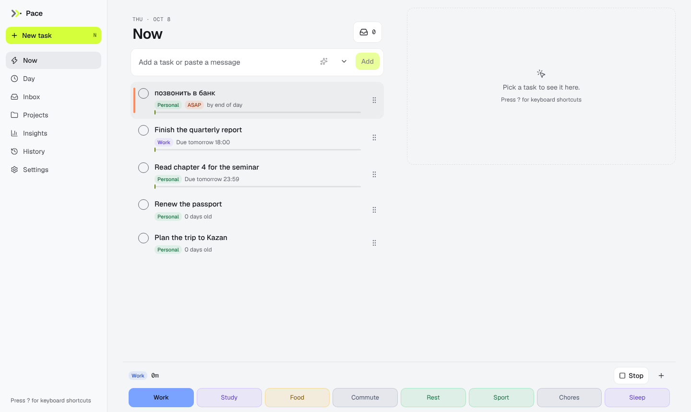
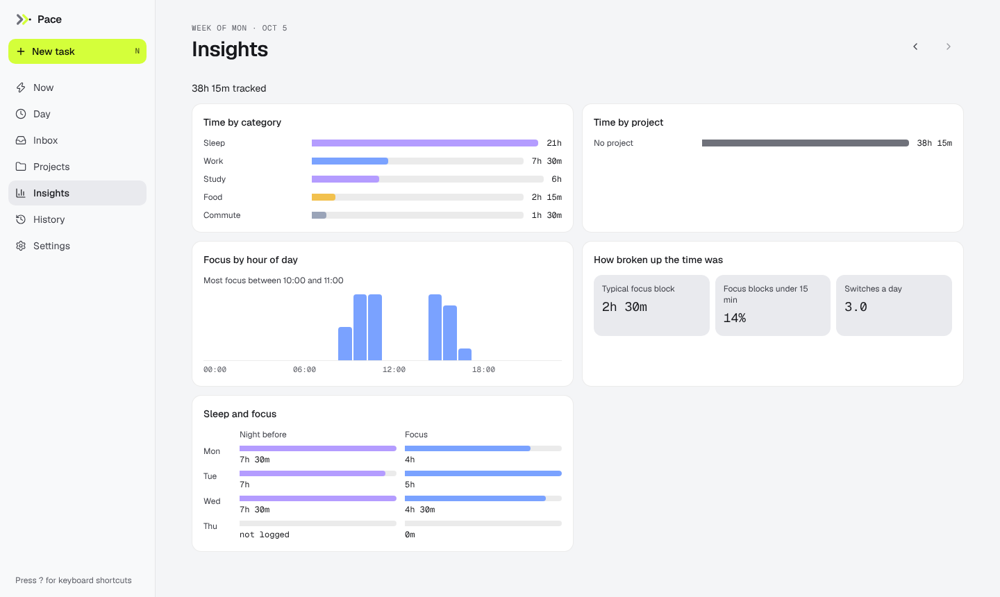
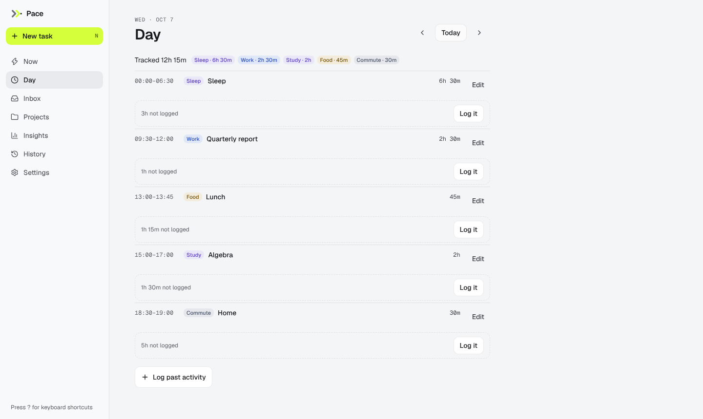
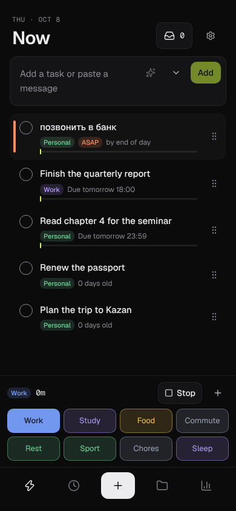

# Pace

A personal task and time tracker that runs at your own pace: an Android app, a web app,
a Telegram bot and an MCP server so Claude, ChatGPT and other assistants can
read and change your tasks. Everything you do is an **immutable event**; every client
keeps its own copy of the log (**local-first**) and syncs it to a **Cloudflare Worker**
that fits in the free tier. One TypeScript code base runs the same business rules on the
phone, in the browser and on the server.

## Status

| Stage | Scope | State |
|---|---|---|
| 0 — Foundation | shared core (events, materializer, settings, i18n, design tokens, API contract), Worker (Telegram auth, bot login, sync), typed client, CI/CD, deploy, brand assets | **done** |
| 1 — Tasks | presets (edited in the web UI), tasks and subtasks, the Now list, projects, inbox, history, MCP minimum with OAuth | **done** — deployed, `v0.1.0` |
| 2 — Language | free-text input parsed by an LLM, the full Telegram bot, notifications, decision log | **done** — deployed |
| 3 — Time | the time ledger: a time bar under Now (one tap switches), focus on a task, the Day timeline (gaps, log past, edit), Insights (time by category and project, on-time rate, estimate vs tracked), phone timers, alerts through the bot, MCP time tools | **done** — `v0.3.0` |
| 4 — Phone and depth | phone data on Day (sleep, phone time per block, calendar), Settings → Permissions and a first-run walk-through, background checks, "ended at …?", calendar series rules; Insights by hour, fragmentation, sleep and focus; Excel export; LLM limits remembered and "read it when it's back"; MCP `query_sql`, `simulate`, `export_all` | **done** — `v0.4.0`, `v0.5.0` |
| 6 — Second feedback round | one sidebar on every desktop screen, Inter everywhere, Now sorted by deadline only (no ranking, no Waiting), quick input and the task form as two steps, every field of a task editable, project pages as task lists; the time bar's four fixed buttons (From calendar, Rest, Sport, Chores), activities alongside the main one, "still doing this?" at twice the Expect instead of limits, typed activities read by the assistant in the background, only accepted calendar events | PR 1 preparing for `v0.10.0`; later work remains in PR 2 and PR 3 |

Still `v0.x`: the product is in daily use but not final.

| Now (desktop) | Insights (desktop) |
|---|---|
|  |  |
| **Day (desktop)** | **Now (phone, dark)** |
|  |  |

The screenshots are taken by `README_SHOTS=docs/screenshots bun test:e2e e2e/readme-shots.e2e.ts`
with a seeded week.

Phone data (`v0.3.1`, Android only): the Day screen reads the phone's own screen and app
events and its calendar, on the device. It proposes last night's sleep from the longest
screen-off stretch, shows phone time and top apps inside each block, and lists the day's
calendar events with Attended / Skip. Confirming a suggestion writes an event; cloud calendar
and app-usage copies are described under [Devices](#devices-calendar-and-app-usage-in-the-cloud).
A first-run walk-through explains and asks for each permission (Settings →
Permissions later). See [Phone data on the device](#phone-data-on-the-device) for what to check.

The three product stages are each meant to be usable daily before the next one starts.

## Architecture

```
apps/app (Expo: Android ──┐                         ┌─ Telegram (webhook: bot login, notifications)
  and the web, through     ├─► packages/client ─► apps/api (Cloudflare Worker, Hono)
  react-native-web; the   │   (typed API client,   │  /api/auth  /api/sync  /telegram/webhook
  web build is served by  │    store, view-models) │
  Worker pace-web)        │                        │
packages/core ◄───────────┘                        ├─ D1 "pace": users, sessions, login_nonces
  events + payload schemas, sort, materialize,     ├─ Durable Object UserStore (SQLite, one per user):
  settings reducer, i18n (en/ru), design tokens,   │    events, decisions, phone data, meta
  zod API contract (endpoints)                     └─ KV OAUTH_KV (MCP OAuth clients, grants, tokens)
```

- `packages/core` is pure TypeScript (no I/O, no React) and is the only thing every
  runtime shares: the event model, the reducers and the API contract.
- `packages/client` turns that contract into a typed `fetch` client and holds the
  local-first app state, the auth flows and the sync loop; `createPaceClient` wires them
  on each platform's adapters (IndexedDB + localStorage on the web, SQLite + SecureStore
  on Android). View-models land here in stage 1.
- `apps/api` mounts the contract on Hono, verifies Telegram logins, serves the bot
  webhook and keeps one Durable Object per user as the server copy of the event log.
- `apps/app` is the one UI over the client: the same screens run on Android and, through
  react-native-web, as the web app (a PWA). Phone-only modules have web stand-ins in
  `src/platform/web/`, and a file can have a `.web.tsx` sibling the web build uses instead.

[docs/architecture.md](docs/architecture.md) has the details: the event envelope,
corrections, deterministic ids, the sync protocol and the recipes for adding an endpoint
or an event type.

## Repository layout

```
packages/
  core/                 @pace/core — pure shared logic (src/core.ts is the public surface)
    src/api/            zod endpoint contract: endpoints.ts + schemas/{auth,sync}.ts
    src/events/         event-schema.ts (envelope + union), payloads.ts, sort.ts
    src/materialize/    materializer.ts (materialize/apply/corrections), settings-reducer.ts
    src/i18n/           en.ts (source of truth), ru.ts, i18n.ts (t, plural, formatters)
    src/design/         tokens.json (dark/light palettes), contrast.ts
    src/ids.ts, time.ts, result.ts
  client/               @pace/client — createPaceClient (api + auth + state + sync), ports and
                        memory adapters; ./react (createAppHooks, useStore); ./testing (fake fetch)
apps/
  api/                  Cloudflare Worker (Hono)
    src/worker.ts       entry: fetch handler + UserStore export
    src/app.ts          createApp(): CORS, config, error shape, route mounting
    src/auth/           Telegram widget HMAC, whitelist, sessions, nonces, routes
    src/bot/            grammY bot (login deep link) + webhook route
    src/sync/           push / pull / live
    src/user-store/     Durable Object (drizzle on SQLite), event-log validation
    src/shared/         config (zod over env), mount() for contract endpoints, D1 schema
    drizzle/d1, drizzle/do   committed migrations (D1 and Durable Object)
    tests/              integration tests inside workerd
    wrangler.jsonc      bindings, vars, dev environment
  app/                  Expo SDK 57 (expo-router, NativeWind, react-native-web): Android and the web
                        app; public/ (web shell, manifest, _headers), wrangler.web.jsonc = Worker pace-web
e2e/                    Playwright + axe
scripts/                build-web.ts (Expo web export + service worker), serve-web.ts, generate-icons.ts
assets/logo/            source SVGs of the mark, wordmark and favicon
.github/workflows/      ci, deploy, release, mutation, llm-regression
docs/                   architecture, testing, linting, presets
```

## Quick start

Prerequisites: [Bun](https://bun.sh) (the version in `.bun-version`). No Docker: the
Worker, D1, KV and the Durable Object run locally in `wrangler dev` (workerd).

```sh
bun install                                   # also installs the git hooks (lefthook)
cp .env.example apps/app/.env                 # optional: the defaults already point at the local Worker
cp apps/api/.dev.vars.example apps/api/.dev.vars   # optional: only needed for a real Telegram login
bun dev                                       # API on http://localhost:8787
bun dev:web                                   # the app in the browser (Expo, port 8081)
```

Without a bot token the API still starts; `POST /api/auth/telegram` answers 503 and the
bot webhook 503, while `POST /api/auth/dev { telegramId }` signs in any id listed in
`ALLOWED_TELEGRAM_IDS` (the `dev` environment in `wrangler.jsonc` is not `production`, so
the route exists).

| Command | What it does |
|---|---|
| `bun dev` | `wrangler dev` (API, port 8787) |
| `bun dev:web` | the app in the browser (`expo start --web`) |
| `bun lint` | every static check with auto-fix: Biome → ESLint → tsc (6 projects) → knip → jscpd → dependency-cruiser → migration drift. See [docs/linting.md](docs/linting.md) |
| `bun test:unit` | Vitest in `packages/core` and `packages/client` (with coverage thresholds) |
| `bun test:api` | Vitest inside workerd with real D1 / KV / Durable Object bindings |
| `bun test:app` | jest-expo + React Native Testing Library |
| `bun test:e2e` | Playwright + axe against `wrangler dev` and the production web build |
| `bun run test` | the four above, in that order |
| `bun test:mutation` | Stryker on core (slow; on demand in CI) |
| `bun test:llm` | one real read through every configured LLM endpoint (`apps/api/scripts/llm-smoke.ts`), run after any change to a provider, its config or the schema; the full parsing regression runner does not exist yet |
| `bun db:generate` | drizzle-kit migrations for both the D1 and the Durable Object schema |
| `bun db:check` | fails when a schema changed without a migration (part of `bun lint`) |
| `bun run build` | production build of the web app (`apps/app/dist`, with the service worker) |
| `bun run --cwd apps/app android` | `expo run:android` on a connected device or emulator |

Playwright needs a browser: `bunx playwright install --with-deps chromium`, or point
`PLAYWRIGHT_CHROMIUM_EXECUTABLE` at an installed Chromium. [docs/testing.md](docs/testing.md)
describes every level.

## How auth works

Pace has no passwords. Telegram is the identity provider and an optional **whitelist**
decides who may use a deployment: `ALLOWED_TELEGRAM_IDS` in `apps/api/wrangler.jsonc`
(comma-separated Telegram user ids). With ids set, anyone else gets `403 auth/not-allowed`
and never gets a user row; left empty (the default), the whitelist is off and any Telegram
account may sign in.

- **Web** — the [Telegram Login Widget](https://core.telegram.org/widgets/login) posts its
  payload to `POST /api/auth/telegram`. The Worker rebuilds the check string, verifies the
  HMAC-SHA-256 with the bot token (timing-safe), rejects payloads older than five minutes,
  checks the whitelist and mints a session.
- **Android** — the app calls `POST /api/auth/nonce` and opens the returned deep link
  `https://t.me/<bot>?start=login_<nonce>`. The bot (webhook `/telegram/webhook`) binds the
  nonce to the Telegram user who opened it, if whitelisted. The app polls
  `GET /api/auth/nonce/:nonce` every few seconds: `{ status: "pending" }` until bound, then
  once `{ status: "ready", token, user }` (the nonce is consumed in that call). Nonces live
  five minutes.
- **Sessions** are bearer tokens: 32 random bytes, only the SHA-256 is stored in D1, valid
  for 90 days, revoked by `POST /api/auth/logout`. `GET /api/me` returns the current user;
  `DELETE /api/me` (Settings → Delete account) deletes the account for good: its event log,
  every session and the MCP clients' grants. A later login of the same Telegram id starts a
  new, empty account.
- **Local and tests** — `POST /api/auth/dev { telegramId }` exists only when
  `ENVIRONMENT` is not `production`.

Deployments for other people: edit `ALLOWED_TELEGRAM_IDS`, `TELEGRAM_BOT_USERNAME` and
`WEB_ORIGIN` in `wrangler.jsonc`, create your own bot (below) and set its token as a secret.

## Deployment

### Cloudflare resources

| Resource | Name / binding | Notes |
|---|---|---|
| Worker | `pace-api` | custom domain `pace-api.nalinor.dev`, `nodejs_compat`, observability on |
| Worker (static assets) | `pace-web` | `apps/app/wrangler.web.jsonc`, serves `apps/app/dist` with SPA fallback, custom domain `pace.nalinor.dev` |
| D1 | `pace` → binding `DB` | migrations in `apps/api/drizzle/d1`; `database_id` in `wrangler.jsonc` is a placeholder until `wrangler d1 create pace` |
| KV | binding `OAUTH_KV` | the MCP OAuth provider's clients, grants and tokens |
| Durable Object | class `UserStore` → binding `USER_STORE` | SQLite-backed, migration tag `v1` |

Create them once (`bunx wrangler d1 create pace`, `bunx wrangler kv namespace create OAUTH_KV`),
put the ids into `apps/api/wrangler.jsonc`, change the two custom domains to yours, and
either run `bunx wrangler deploy` in `apps/api` and `bun run build && bun run --cwd apps/app deploy:web`, or let
the workflow do it.

### GitHub Actions

| Workflow | Trigger | Does |
|---|---|---|
| `ci.yml` | pull requests and pushes to `main` (not for docs-only changes), manual | one checks job (lint with a clean tree afterwards, `bun audit`, unit, app, api), then e2e once it passes; manual runs also build the arm64 **release APK** as an artifact (R8 and all, unpublished; the step summary shows its size) |
| `deploy.yml` | after a green CI on `main`, or manual | builds the web app (`bun run build:web` in `apps/app`, `EXPO_PUBLIC_API_URL=https://pace-api.nalinor.dev`), applies D1 migrations (`wrangler d1 migrations apply pace --remote`), deploys `pace-api` and `pace-web`, pushes the Worker secrets that are set, stores `BOT_INFO` (`getMe`), calls `setWebhook`, smoke-tests both hosts |
| `release.yml` | tag `v*` | lint + unit + api + app, builds the release APK (arm64-v8a), publishes a GitHub Release with `pace-vX.Y.Z.apk`, sends the APK to the owner in Telegram when `TELEGRAM_RELEASE_CHAT_ID` is set |
| `mutation.yml` | manual | Stryker on core and web |
| `llm-regression.yml` | manual | `bun test:llm` against the `LLM_*_N` endpoints set in GitHub |

Secrets and variables read by the workflows:

| Name | Kind | Used by | Purpose |
|---|---|---|---|
| `CLOUDFLARE_API_TOKEN` | secret | deploy | Workers Scripts, D1, KV, custom domains for the account |
| `CLOUDFLARE_ACCOUNT_ID` | variable (secret also accepted) | deploy | account the Workers live in |
| `TELEGRAM_BOT_USERNAME` | variable | deploy | baked into the web build as `EXPO_PUBLIC_TELEGRAM_BOT` (defaults to `PaceTaskTrackerBot`) |
| `TELEGRAM_BOT_TOKEN` | secret | deploy, Worker | widget verification and bot replies; without it login and the webhook stay disabled |
| `TELEGRAM_WEBHOOK_SECRET` | secret (optional) | deploy, Worker | string Telegram echoes on every webhook call; when unset, deploy derives it as the SHA-256 of the bot token |
| `TELEGRAM_WEBHOOK_ALLOWED_CIDRS` | var in `wrangler.jsonc` | Worker | comma-separated IPv4 CIDRs the webhook accepts calls from, checked against `CF-Connecting-IP`; default `149.154.160.0/20,91.108.4.0/22` ([Telegram's subnets](https://core.telegram.org/bots/webhooks#the-short-version)); empty = the check is off |
| `LLM_BASE_URL_N` | variable (secret also accepted) | deploy, llm-regression | OpenAI-compatible API prefix of LLM slot N (1–5 from GitHub, any N set on the Worker directly; 1 is asked first), including its `/v1` path; set together with `LLM_API_KEY_N` and `LLM_MODEL_N` |
| `LLM_MODEL_N` | variable (secret also accepted) | deploy, llm-regression | one or more model identifiers of slot N, comma separated, each its own priority |
| `LLM_API_KEY_N` | secret | deploy, llm-regression | one or more keys of slot N, comma or newline separated; a rate-limited key rests while the next one answers |
| `TELEGRAM_RELEASE_CHAT_ID` | variable (optional) | release | Telegram user id that gets each release's APK from the bot (with `TELEGRAM_BOT_TOKEN`); unset = nothing is sent |
| `ANDROID_KEYSTORE_BASE64`, `ANDROID_KEYSTORE_PASSWORD`, `ANDROID_KEY_ALIAS`, `ANDROID_KEY_PASSWORD` | secrets | release | optional release keystore; absent → debug keystore |
| `GOOGLE_SERVICES_JSON` | secret | release | the Firebase `google-services.json` (raw JSON) for push through FCM; absent → the APK has no Google push and phones poll |
| `FIREBASE_SERVICE_ACCOUNT` | secret | deploy, Worker | the Firebase service account's JSON key the Worker sends pushes with; absent → push is off, everything else works |

Worker secrets are pushed with `wrangler secret put` only when the GitHub secret is set, so
a fork deploys without a bot token. `BOT_INFO` is stored as a secret too, by the workflow.
Non-secret configuration (`ENVIRONMENT`, `ALLOWED_TELEGRAM_IDS`, `TELEGRAM_BOT_USERNAME`,
`TELEGRAM_WEBHOOK_ALLOWED_CIDRS`, `WEB_ORIGIN`) lives in `wrangler.jsonc`. Deploy pushes every
`LLM_*_N` (N = 1–5) it finds among the GitHub secrets and variables, removes slots 1–5 GitHub no
longer has (a slot of 6 or more set on the Worker stays), and leaves the Worker's LLM settings alone when GitHub has none (so endpoints set
with `wrangler secret put` survive). For local Worker development, copy
`apps/api/.dev.vars.example` to `apps/api/.dev.vars` and fill in a slot.

## Android release

Releases are APKs (arm64-v8a, about 25 MB) on GitHub Releases, not the Play Store, and there are no OTA updates.
Set the repository variable `TELEGRAM_RELEASE_CHAT_ID` to your Telegram user id to get each
release's APK from the bot (open the bot once first); a bot may send files up to 50 MB, and the
release job fails the Telegram step if the APK ever grows past that.
`apps/app/app-version.ts` derives `version` and `versionCode` from the tag (`v1.2.3` →
`1.2.3`, `10203000`). A build between releases sits on the last tag (`git describe`):
`1.2.3-dev.7+cfd5334` (7 commits since), and its code adds the hours from the tag's commit to
the built one (`10203030` thirty hours on, at most 999), so it installs over that release, the
next release installs over it, and main after a squash merge installs over the branch's build.

- **Signing today: the standard Android debug keystore**, committed at
  `apps/app/keystores/debug.keystore` (`android` / `androiddebugkey` / `android`).
  `apps/app/plugins/with-release-signing.js` makes release builds use it when no release
  keystore is configured, so every build has the same signature and installs over the
  previous one. Release notes say "debug-signed". Anyone can sign with that key, so the
  signature proves nothing about who built the APK (see [SECURITY.md](SECURITY.md)).
- **Switching to a real keystore**: generate one (`keytool -genkeypair -v -keystore
  release.keystore -alias pace -keyalg RSA -keysize 2048 -validity 10000`), add the four
  `ANDROID_*` secrets (`ANDROID_KEYSTORE_BASE64` is `base64 -w0 release.keystore`), and
  tag a release. The plugin reads them as Gradle properties `PACE_STORE_FILE`,
  `PACE_STORE_PASSWORD`, `PACE_KEY_ALIAS`, `PACE_KEY_PASSWORD`. Users must uninstall the
  debug-signed app once; the signature changes.
- **App Links**: `apps/app/public/.well-known/assetlinks.json` lists the SHA-256 of the
  signing certificate for package `dev.nalinor.pace`, so `https://pace.nalinor.dev/app/*`
  opens in the app (intent filter with `autoVerify` in `app.config.ts`). After switching
  keystores, replace the fingerprint (`keytool -list -v -keystore release.keystore`) and
  redeploy the web Worker.
- The native project (`apps/app/android`) is generated by `expo prebuild` and gitignored.
  CI uses JDK 17, NDK 27.1 and builds `arm64-v8a` only.
- **Installing from the APK**: Pace is not in a store, so Android 13+ treats usage access as a
  "restricted setting" and greys it out ("App was denied access"). Lift it once: *Settings →
  Apps → Pace → ⋮ → Allow restricted settings*, then grant usage access. The ⋮ item appears only
  after a first, refused try at the switch, so on Android 13+ the usage step of the permissions
  screen and the walk-through leads through the three steps, its button the step to take now. Reminders are plain notifications:
  no exact-alarm permission (the manifest blocks it), so one may come a few minutes late in Doze.
- **Size**: release builds run R8 and drop unused resources, and native libraries are
  compressed (`expo-build-properties` in `app.config.ts`, guarded by `app.config.test.ts`).
  Without that the APK is ~50 MB: every class of every library stays, all of Jetpack Compose
  among them (expo-router links it through `@expo/ui`).
- **Crash traces**: a crash, a JS error at start included, writes its trace to
  *Download/Pace/crash-<date-time>.txt* (Android 10+; on older ones
  `Android/data/dev.nalinor.pace/files`) before the app closes, so it can be shared without
  adb (`CrashCatcher.kt` in `modules/pace-native`); the next start says where in a toast. An
  error the crash screen shows is saved there too, and the screen gives the path.
  Next to the trace: the build, device model, Android version, language and UTC offset,
  memory, power saving, dark mode, granted permissions (`DebugInfo.kt`) and what the app was
  doing: the screen with ids masked, signed in or not, sync state (`crash-context.ts`). Never
  names, the Telegram account, tokens, account or device ids, tasks, events, calendar, app
  usage or the time zone's name.
- **Hermes**: React Native 0.86's Hermes lacks `Array.prototype.toSorted`, `Object/Map.groupBy`,
  the iterator helpers and `Intl.PluralRules`. `entry.ts` loads `src/platform/polyfills.ts`
  (core-js, plus `crypto.getRandomValues` from expo-crypto) before any route; `@pace/core`
  writes the plural rules out. A newer builtin needs a line there, or the phone crashes.

## Devices: calendar and app usage in the cloud

The phone can send its calendar (own and accepted events) when *Settings → Devices → Send this
phone's calendar* is enabled for the current login. A new login starts with this switch off;
turning it off deletes that login's cloud copy. The phone also sends the apps it had in front,
names and times only. A computer
runs Pace's own agent (one Python file, standard library only, for Windows, macOS and Linux):
*Settings → Devices → Add a computer* gives one install line per system (see
[docs/desktop.md](docs/desktop.md)). Day and Week show where the
time of each block went; MCP has `get_calendar`, `get_usage` and `get_week`.

## Phone data on the device

This part depends on Android itself and is checked on a real phone, not in CI (CI compiles
the native code and runs the JS logic against mocks).

- **First run**: after login a short walk-through lists the four permissions Pace may use
  and why: notifications, calendar, usage access, alarms on time. It then asks for each
  one that is off, one at a time. A dialog moves on by itself. A settings screen moves on
  once you come back with it turned on, or you press Skip. "Not now" skips the whole thing.
  It is shown once per phone.
- **Settings → Permissions**: the same four, each with its state (on / off / turned off in
  Android settings) and one button. Calendar series you answered "every time" are listed
  there too, each with Forget.
- **Sleep**: after a night with the phone idle for at least 3 h touching 21:00–12:00,
  the Day screen shows a "Last night" card with the times and how often you woke up
  (screen-on glances up to 5 min are merged into the night). *Log sleep* writes a `sleep`
  block; *Not sleep* hides that guess on this phone.
- **Phone time per block**: under each block on Day, "Phone 25m: YouTube, Telegram…"
  sums foreground app time inside it. It only shows where the time went: nothing is taken
  off the block.
- **Ended at …?**: when a running activity is past its Expect and you pick up the
  phone, the running row on Day offers to end it at the moment of the pickup.
- **Calendar**: "From your calendar" lists the day's timed events from every visible
  calendar that are yours to attend: your own events and subscriptions, and invitations you
  accepted (declined, tentative and unanswered ones, and all-day events, are skipped). The
  time bar sits at the foot of Day (today). Every one of its buttons (*Calendar*, *Task*,
  *Chores*, *Rest*) opens a picker, with *Stop* first when that button's activity runs.
  *Calendar*'s picker lists today's events; one picked starts under its title, from its
  start. When nothing is near now (starting, going on or just over within 15 minutes), or
  without access, the button is greyed: its tooltip and its picker say why, and the picker
  still offers a meeting without an event. Now shows what runs in one compact row with
  *Stop*. *Attended* (offered from 15 minutes before the start) tracks the event from its
  start, as Now's offer does. *Skip* skips that occurrence on every channel (Telegram, the web
  and the feed stop asking); one that did not reach the server stays, with a note to try again.
  For a repeating event, the toast offers *Every time*: the whole series is then logged when it
  ends, or always hidden. Exchange or work accounts appear only if
  Android syncs them into its calendar provider.
- **Notifications** come from the server only (see [Notifications](#notifications)); the
  phone computes and schedules none of its own.

## Notifications

One pool on the server holds every notification, and each channel shows it: Telegram, the app
and the web (a bell with an unread count in the sidebar header and on Now's phone header; the
`/notifications` screen, grouped by day, with the assistant's log one link away). Kinds and their
default channels (*Settings → Notifications* switches each kind per channel):

| Kind | What | Default |
|---|---|---|
| Sign-in | a new session (who, where from) | Telegram, app, web |
| Deadline digest | at each digest time: open tasks due before a day after the next digest time, each task and deadline once | Telegram |
| Event starting | a calendar event (own or accepted, not all-day) as it starts: *Attend* / *Skip* | Telegram |
| Still doing X? | the running activity at twice its Expect: *Yes, still* / *Stop* | app |

An answer anywhere resolves the notification everywhere: answered in Telegram, the message is
edited; from anywhere else (the app, the web, Now's offer, a phone notification) the Telegram
message is deleted and the phone's copy is taken back. An event attended from Now resolves its
notification too; one not answered by its end expires. Quiet hours hold back "event starting"
and "still doing X?"; sign-ins and digests always come.

The phone gets system notifications one way, chosen at each start: Google's push (FCM) when the
server offers it and the phone has a Google token, else polling (it fetches what waits for it;
the open app does so at once on each live update). *Settings → Notifications* on the phone picks
it by hand (*Auto*, *Google*, *Pace checks* or *Off*) and says which one the phone uses; a pick the
server or the phone cannot take right now falls back to the other, and is tried again later. `GET /api/push/methods` says what the server
accepts. If Google refuses the server's Firebase credentials, the server stops offering FCM and
phones switch to polling on their next start or at once while open. Each item's delivery log
("Delivered to android via Google · 13:47") is shown under it in the feed.

### Push notifications (Firebase)

1. In the [Firebase console](https://console.firebase.google.com/) create a project (no
   Analytics needed).
2. *Add app → Android*, package name `dev.nalinor.pace`. Download `google-services.json` and
   store its contents as the GitHub secret `GOOGLE_SERVICES_JSON`; the release workflow writes
   it next to `app.config.ts` (`GOOGLE_SERVICES_FILE`) before prebuild.
3. *Project settings → Cloud Messaging*: make sure **Firebase Cloud Messaging API (V1)** is
   enabled.
4. *Project settings → Service accounts → Generate new private key*: store the downloaded JSON
   as the GitHub secret `FIREBASE_SERVICE_ACCOUNT`; the deploy workflow puts it into the Worker.
5. Release a new APK and deploy. Without either secret everything works and phones poll.

Both secrets must come from the **same** Firebase project: FCM refuses every push to a token
another project issued (`SENDER_ID_MISMATCH`). The APK knows the project it was built with and
`GET /api/push/methods` says the server's (`fcmProject`); when they differ (a self-hosted server
with its own project, say) the phone polls and Settings says why. A phone that got a token
refused anyway (an older APK) is moved to polling by the server, and its token is not taken for
FCM again while the server sends with that project.

## Telegram bot setup

1. In [@BotFather](https://t.me/BotFather): `/newbot` → note the username and the token.
2. `/setdomain` → the web origin (`pace.nalinor.dev` for this deployment) so the Login
   Widget may run there. A bot has one widget domain.
3. Put the username into `TELEGRAM_BOT_USERNAME` (`wrangler.jsonc` and the GitHub
   variable), the token into the `TELEGRAM_BOT_TOKEN` secret; `TELEGRAM_WEBHOOK_SECRET` is optional
   (derived from the token when unset).
4. The deploy workflow sets the webhook to `https://<api host>/telegram/webhook` with
   that secret (`allowed_updates: message, callback_query`) and stores `getMe` as
   `BOT_INFO` so the Worker never calls Telegram on a cold start. For a manual setup call
   `setWebhook` yourself and `bunx wrangler secret put BOT_INFO` with the `result` of `getMe`.
5. The webhook answers only calls from [Telegram's subnets](https://core.telegram.org/bots/webhooks#the-short-version):
   `TELEGRAM_WEBHOOK_ALLOWED_CIDRS` in `wrangler.jsonc` (default
   `149.154.160.0/20,91.108.4.0/22`) is matched against the `CF-Connecting-IP` header,
   which Cloudflare sets itself on every request that reaches the Worker, so a caller
   cannot forge it. Any other address — or a missing header — gets `403 bot/forbidden-ip`
   (logged at warn level) before the secret token is even read; a typo in the list fails
   config loading with a message naming the entry. Set the var to an empty string to turn
   the check off, e.g. in `.dev.vars` when a tunnel that is not Cloudflare's (ngrok)
   delivers the webhook to `wrangler dev`. When Telegram changes its subnets, update the
   var and redeploy.

What the bot does, in the account language:

- `/start login_<nonce>` logs the app in (and opens the chat notifications go to).
- Any text is read by the assistant and answered with a preview — "I read it as: …" with
  the fields and anything it could not verify marked — and **Accept** / **To Inbox** /
  **Cancel**. Accept writes exactly the previewed events; nothing is written before. When no
  model has requests left, the text goes straight to the Inbox and the reply says when the
  assistant is back.
- `/now` lists the top five of Now.
- Notifications: the kinds on for Telegram (see [Notifications](#notifications)), with
  *Attend* / *Skip* under an event starting and *Yes, still* / *Stop* under "still doing X?".
  An answer there edits the message; an answer anywhere else deletes it. The Durable Object's
  alarm drives the pool and re-arms itself after every write.

## MCP

Pace is an MCP server: `https://pace-api.nalinor.dev/mcp` (streamable HTTP) behind OAuth 2.1
with PKCE, dynamic client registration and a branded consent page on the web origin where you
sign in with Telegram and pick the scopes. Claude (web, desktop, Code), ChatGPT connectors,
Cursor and MCP Inspector connect with just that URL. The stage-1 tools cover the whole task
loop: `whoami`, `list_now`, `get_task`, `list_projects`, `list_project_tasks`,
`list_presets`, `list_inbox`, `list_review`, `search_decisions`, `search` and `fetch` (the pair ChatGPT needs)
to read (`tasks:read`); `create_task`, `capture_inbox`, `mark_subtasks`, `submit`,
`close_task`, `reopen`, `update_task`, `set_importance`, `set_status`,
`add_subtasks`, `revoke_event`, `review_action`, `seed_example_presets`, `create_preset`,
`update_preset` and `archive_preset` to write (`tasks:write`). Every write takes `at`
(retroactive records), `precision` and `dryRun` (preview without writing), answers the
recorded event ids for undo, and refusals come back as tool errors (`isError`) that start
with the Result code. The tools read and write through your Durable Object, so they see
the state the apps sync: this week's homework instances and automatic outcomes are derived
before every read and after every write. [docs/mcp.md](docs/mcp.md) has
the setup per client, the tools table, the scopes, the consent flow and local testing.

## LLM providers

Free text ("дз 7 по алгебре 1, 3, 5а до среды 23:59") can be read by any
OpenAI-compatible model with JSON-schema output, through the AI SDK. Endpoints are numbered
slots in the Worker environment: `LLM_BASE_URL_N`, `LLM_API_KEY_N` and `LLM_MODEL_N` together,
for any N; the base URL is the API prefix (usually ending in `/v1`). A slot may list several
models (each its own priority, in order) and several keys (each with its own rate-limit
cooldown). The production order is the main gateway's two models, then Gemini
(`https://generativelanguage.googleapis.com/v1beta/openai`, `gemini-flash-latest`), then Groq
(`https://api.groq.com/openai/v1`, `openai/gpt-oss-120b`).

The models are raced, not queued: the first is asked; when it fails, or has not sent its first
token within 5 seconds, the next one is asked as well, and so on down the list; the first valid
answer wins and the rest are cancelled. Each failure is logged (`llm: provider failed`, with the model and the reason) in the
Worker's logs. Tests and the e2e Worker use an in-process fake (`LLM_PROVIDER=fake`). If no
model is configured or all are unavailable,
the API and bot offer rule-based previews in English and Russian: tasks preserve their entered
title, typed time spans create or log activities, and common meal words such as “ем” and
“eating” select Food. The bot asks whether ambiguous text is a task or an activity before
offering Approve. The prompt (categories, projects, up to 40 open tasks and today's and
yesterday's activities under short aliases such as `t3` and `a2`, never their ids, now, zone)
stays under 3k tokens.

The LLM never rewrites your text: the line is stored verbatim, every extracted string must
be a literal quote of it, and numbers and dates need a quote as evidence — anything else
comes back marked "check this". Where it is used:

- `POST /api/parse` — `{ text, domain: "task" | "activity" | "auto" }` → proposals for the
  person to accept: create, edit, delete or close a task (or add and mark its subtasks);
  start, log, edit or delete an activity. Each comes with a summary written by code. The
  model answers with aliases of the lists it was shown; code maps them back and checks
  them: an alias outside the lists is dropped, a delete must quote the item's title, times
  must name real minutes. With `auto` it also says whether the text is about a task or an
  activity and how sure it is (below `CLASSIFY_CONFIDENT` = 0.8 the bot asks). Without a
  model the rules propose a new task, or the activity a typed span names ("7:30 - 8:30 -
  ходил в военкомат" is logged). The composer's assistant preview (web and app) fills the
  same chips the rule-based reading does; questions show as one-tap answers.
- The bot's previews (above).
- `GET /api/decisions` and the **Decision log** page (Settings), plus the MCP tool
  `search_decisions`: every parse and every notification sent or held back, with the rule,
  its inputs and a one-line explanation.

**When the endpoints run out of requests**: a key's rate limit is remembered (from its
`retry-after`) and skipped until then, so the next calls go straight to the one still
answering; `GET /api/llm/status` says whether the assistant can read now and when it is back.
With every key out, `POST /api/parse` still returns a rule-based preview; clients may explicitly
request deferred reading. A deferred result links to each task it created. The bot offers an
immediate rule-based preview instead of silently queuing an unapproved message.

## License

[MIT](LICENSE).
